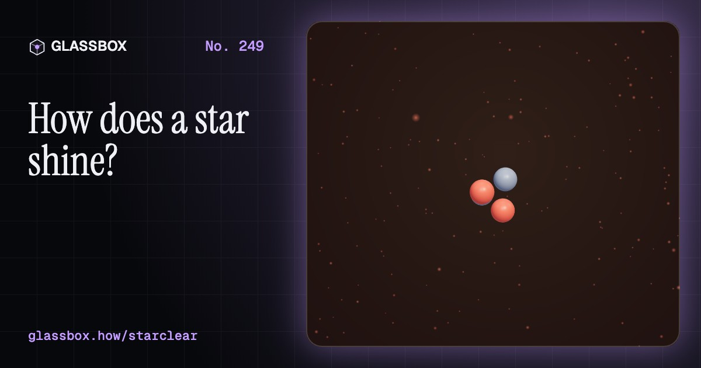
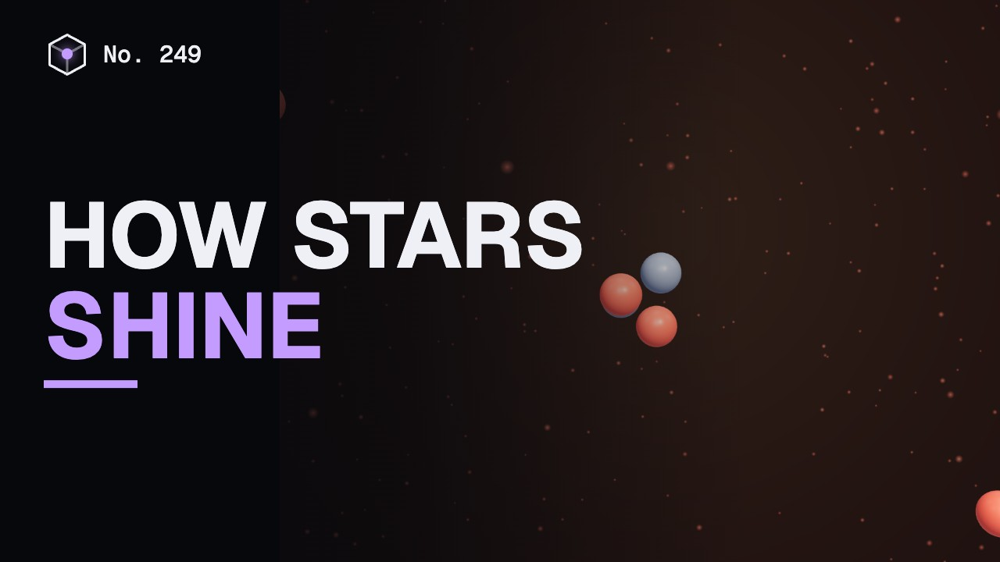
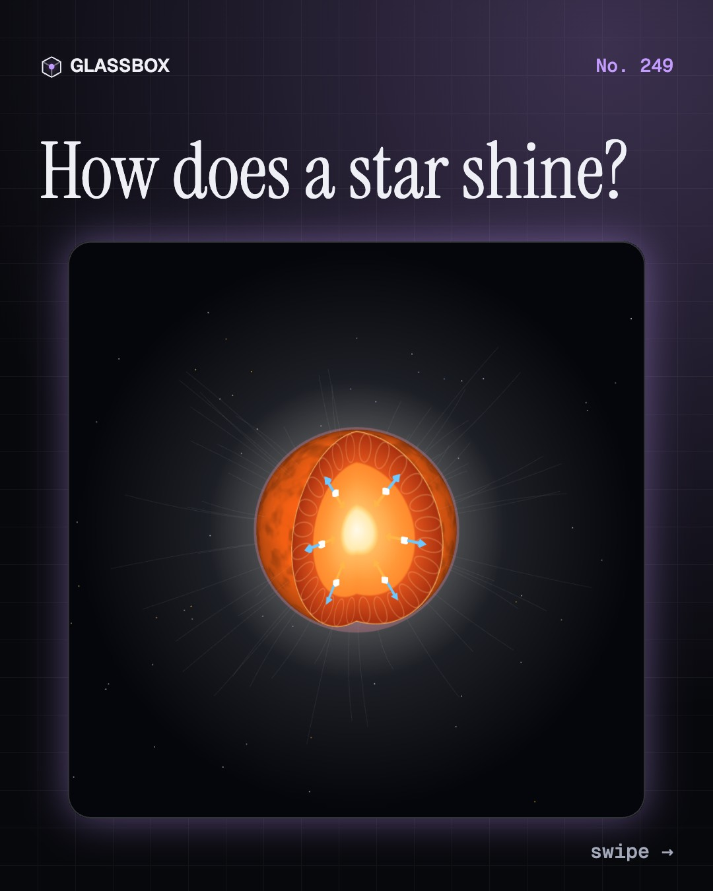
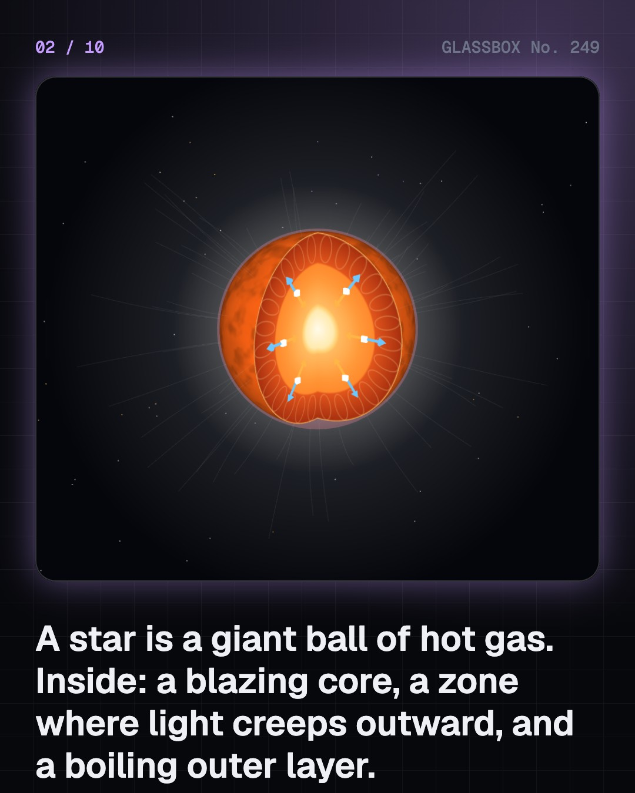
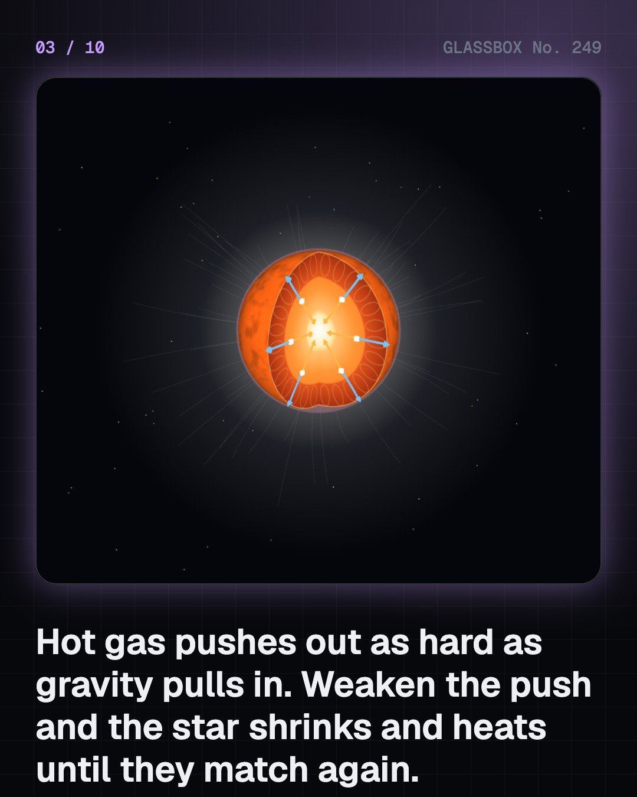
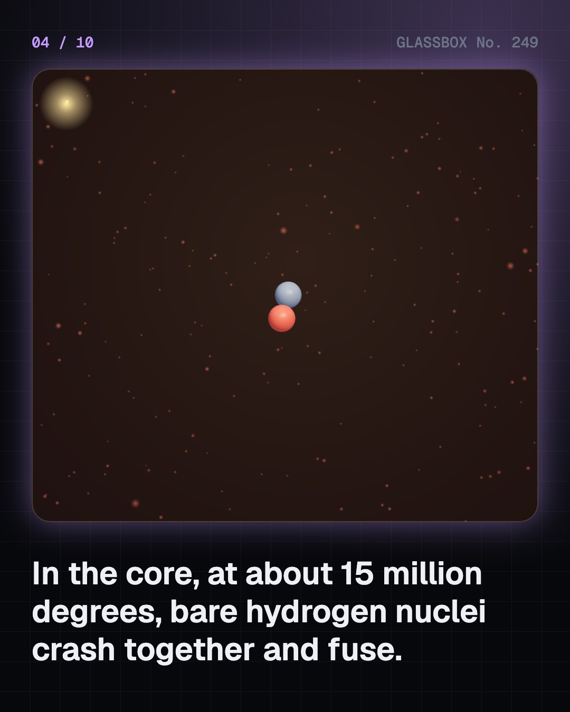

<!-- glassbox:start -->
<!-- Generated from glassbox.json by the Glassbox hub (npm run readme -- starclear). Edit glassbox.json, not this block. -->
<p align="center"><a href="https://glassbox.how/e/starclear/"></a></p>

<h1 align="center">StarClear</h1>

<p align="center"><b>How does a star shine?</b><br>Every second the Sun turns about 4 million tonnes of itself into light. Open a star, watch hydrogen fuse into helium, follow light on its thousands-of-years walk out, and see how a star's mass decides its colour, its life and its death.</p>

<p align="center"><a href="https://glassbox.how/starclear/"><b>▶ Play with it</b></a> &nbsp;·&nbsp; <a href="https://glassbox.how/e/starclear/">Read the 60-second explainer</a></p>

<p align="center">
  <a href="https://glassbox.how/e/starclear/"></a>
  <a href="https://glassbox.how/e/starclear/"></a>
  <a href="LICENSE"></a>
  <a href="LICENSE-CONTENT.md"></a>
  <a href="#privacy"></a>
</p>

## In 60 seconds

1. **A ball of gas in balance.** A star is a huge ball of hot gas. Gravity pulls it inward; the pressure of hot, squeezed gas pushes out. Where the two match, the star holds steady for billions of years.
2. **Fusion in the core.** At about 15 million K, hydrogen nuclei fuse. Step by step, four of them become one helium nucleus that weighs about 0.7% less. The missing mass becomes energy, E = mc².
3. **A wall and a tunnel.** Protons repel each other, and few have the energy to get close. Quantum tunnelling lets a small fraction slip through the barrier anyway. Heavier stars mostly use the CNO cycle instead.
4. **The long walk out.** Light from the core is absorbed and re-emitted countless times. Estimates for how long energy takes to leave the radiative zone range from about 10,000 to 170,000 years. Convection then carries it up, and from the surface it reaches Earth in about 8 minutes 20 seconds.
5. **Mass sets colour and brightness.** Heavier stars have hotter cores, burn far faster and look bluer. Red stars are about 3,000 K, blue ones above 20,000 K. On the Hertzsprung-Russell diagram most stars sit on the main sequence.
6. **How stars end.** The Sun is about 4.6 billion years into a roughly 10-billion-year life. It will become a red giant and then a white dwarf. Stars above about 8 Suns explode as supernovas, leaving neutron stars or black holes, and scatter the elements we are made of.

## Words worth knowing

| Term | Meaning |
|---|---|
| **Hydrostatic equilibrium** | The balance between gravity pulling a star inward and gas pressure pushing outward. |
| **Nuclear fusion** | Light nuclei joining into heavier ones, releasing energy. |
| **Proton-proton chain** | The series of reactions that turns four hydrogen nuclei into one helium nucleus in the Sun. |
| **CNO cycle** | A fusion route in which carbon, nitrogen and oxygen act as catalysts; dominant in stars heavier than about 1.3 Suns. |
| **Quantum tunnelling** | A particle passing through an energy barrier it could not climb over, thanks to its wave nature. |
| **Random walk** | A path of steps in random directions; light leaving the Sun's interior follows one. |
| **Convection** | Heat carried by rising hot gas and sinking cool gas, as in the Sun's outer layer. |
| **Neutrino** | A nearly massless particle from fusion that passes through almost everything. |
| **Hertzsprung-Russell diagram** | A chart of stars by temperature and brightness, showing the main sequence, giants and white dwarfs. |
| **Nucleosynthesis** | The making of chemical elements inside stars and stellar explosions. |

## A short history

**From a Greek thinker's 'red-hot stone' to detectors deep underground that catch particles from the Sun's core.**

- **450 BCE** · The Sun is a hot stone, not a god (Anaxagoras of Clazomenae, Athens, Greece)
- **1854** · The shrinking-Sun idea (Hermann von Helmholtz, Germany)
- **1859** · Reading the elements in light (Gustav Kirchhoff and Robert Bunsen, Heidelberg, Germany)
- **1901** · O, B, A, F, G, K, M (Annie Jump Cannon, Harvard College Observatory, Cambridge, Massachusetts)
- **1913** · A map of all the stars (Ejnar Hertzsprung and Henry Norris Russell, Europe, and Princeton, USA)
- **1920** · Eddington proposes fusion (Arthur Eddington, Cardiff, Wales)
- **1925** · Stars are mostly hydrogen (Cecilia Payne, Harvard College Observatory, Cambridge, Massachusetts)
- **1939** · How stars shine, worked out (Hans Bethe, with Charles Critchfield, United States)

The full story, with 34 moments, charts, people and 50 sources: [glassbox.how/e/starclear/history](https://glassbox.how/e/starclear/history/). The data lives in [`history.json`](history.json).

## Video and slides

Made with the Glassbox studio from this box's storyboard (`window.glassbox.director`). Free to reuse under CC BY 4.0.

<a href="https://glassbox.how/starclear/glassbox/video.mp4"></a>

<p><a href="glassbox/slide-1.jpg"></a> <a href="glassbox/slide-2.jpg"></a> <a href="glassbox/slide-3.jpg"></a> <a href="glassbox/slide-4.jpg"></a></p>

| File | What | Size |
|---|---|---|
| `glassbox/slide-1…10.jpg` | Instagram carousel | 1080×1350 |
| `glassbox/thumb.jpg` | YouTube thumbnail | 1280×720 |
| `glassbox/cover.jpg` | Share card and repo social preview | 1200×630 |

## Privacy

This box has no accounts and no ads, and it ships its own fonts and libraries. When you run it yourself it sends nothing anywhere. On glassbox.how, the site's `/bar.js` also loads Glassbox's analytics: **Google Analytics** to count visits (it asks first in the EU, UK and Switzerland, and stays off when your browser sends Global Privacy Control or Do Not Track) and **ClickTrust** to detect bots.

It remembers a few things **in your own browser only**, and never sends them anywhere:

| Browser storage key | What it holds |
|---|---|
| `starclear.v1` | Which chapters you have opened, your best quiz scores, and sound on or off. |

Exactly what each one sees is at [glassbox.how/privacy](https://glassbox.how/privacy/).

## Licences

- **Code:** [MIT](LICENSE). Use it, change it, ship it.
- **Explanations, text, images and videos** (`glassbox.json`, `glassbox/`): [CC BY 4.0](LICENSE-CONTENT.md). Credit “Glassbox, glassbox.how/e/starclear”.
- **Third-party parts** keep their own licences: [three.js](https://threejs.org) (MIT), [Geist, Instrument Serif](https://openfontlicense.org) (SIL OFL 1.1), [CIE colour-matching fit (Wyman, Sloan and Shirley 2013), used as published equations for star colours](https://jcgt.org/published/0002/02/01/) (Formula; implemented from scratch).
- The Glassbox name and logo aren't covered by either licence. See the [terms](https://glassbox.how/terms/).

Found a mistake? [Open an issue](https://github.com/bdeeps/starclear/issues). Corrections happen in public.
<!-- glassbox:end -->

## Run it

It's plain HTML, CSS and JavaScript. No build step and no dependencies. Run locally, it contacts no other website.

```bash
python3 -m http.server 8000
```

Three.js and the fonts ship in `vendor/` and `fonts/`, so it also works offline.

Then open http://localhost:8000.

## How it's built

| File | What |
|---|---|
| `index.html`, `css/app.css` | The page and its styles |
| `js/app.js`, `js/stage.js`, `js/ui.js`, `js/kit.js` | The shared Glassbox 3D engine: chapters, 3D stage, controls, quiz, video director |
| `js/chapters/*.js` | One file per chapter: the 3D model, controls, text, key terms, quiz and video scenes |
| `glassbox.json` | Title, question, explainer beats, key terms, browser storage and credits shown on glassbox.how |
| `reel` in each chapter | The storyboard the Glassbox studio records into short videos |
| `glassbox/` | The published video, slides, thumbnail and post copy |
| `fonts/`, `vendor/three/` | Self-hosted Geist and Instrument Serif (SIL OFL 1.1) and three.js (MIT) |
